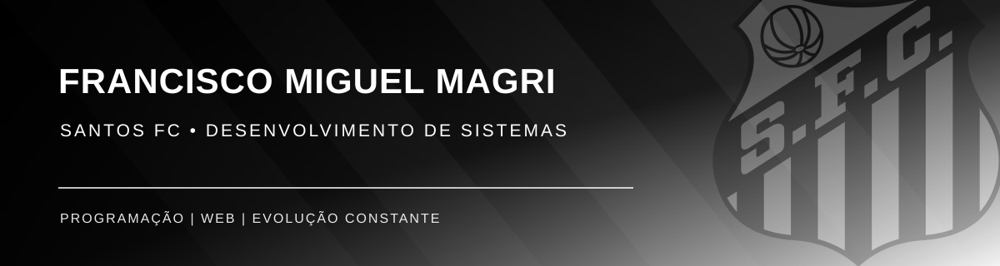
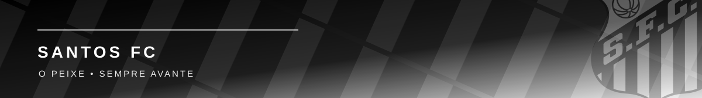

  

  <h2>⚫⚪ Francisco Miguel Magri</h2>
  
<strong>Estudante de Desenvolvimento de Sistemas</strong>

  
Programação · Desenvolvimento Web · Aprendizagem contínua

  
  
  

 

  

  <strong>⚫⚪ Tecnologia, dedicação e evolução constante.</strong> 
  Construindo projectos com foco em programação, desenvolvimento web e aprendizagem contínua.

  

---

## ⚫⚪ Sobre mim

Sou **Francisco Miguel Magri**, estudante de **Desenvolvimento de Sistemas** e apaixonado por tecnologia. Estou a construir a minha jornada através de projectos práticos, estudo constante e desafios que me ajudam a melhorar a lógica, a criatividade e a resolução de problemas.

O meu objectivo é evoluir na programação, aprofundar conhecimentos em desenvolvimento web e preparar-me para novas oportunidades académicas e profissionais na área de tecnologia.

> **Mentalidade:** aprender, praticar, melhorar e seguir sempre avante.

## 🏁 Stack em desenvolvimento

  

 

  
  
  
  
  
  

## 🏆 Projectos em destaque

  
  
  
  
  

## 🎯 Objectivos

- Evoluir continuamente em programação e Desenvolvimento de Sistemas.
- Criar projectos cada vez mais completos, organizados e funcionais.
- Aprofundar conhecimentos em desenvolvimento web e novas tecnologias.
- Fortalecer boas práticas de código, versionamento e trabalho colaborativo.
- Transformar aprendizagem em resultados concretos.

## 📊 Estatísticas

  
   
  

## ⚽ Vamos conectar

Se também gostas de programação, desenvolvimento web, tecnologia e de acompanhar projectos em evolução, fica à vontade para conhecer o meu trabalho.

  

 

  

